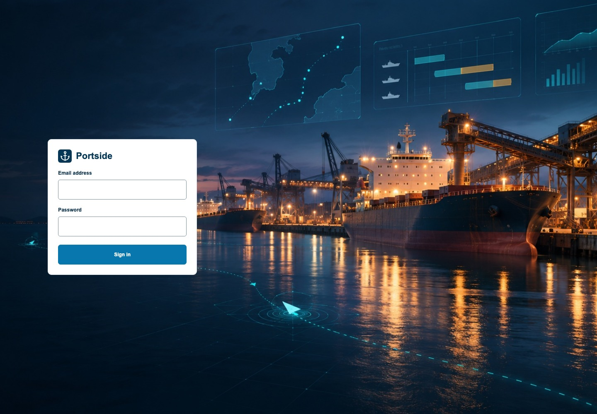
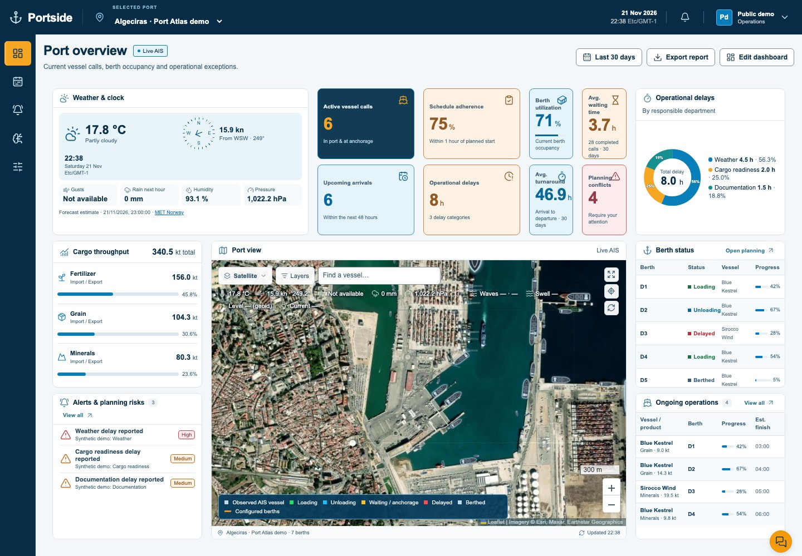
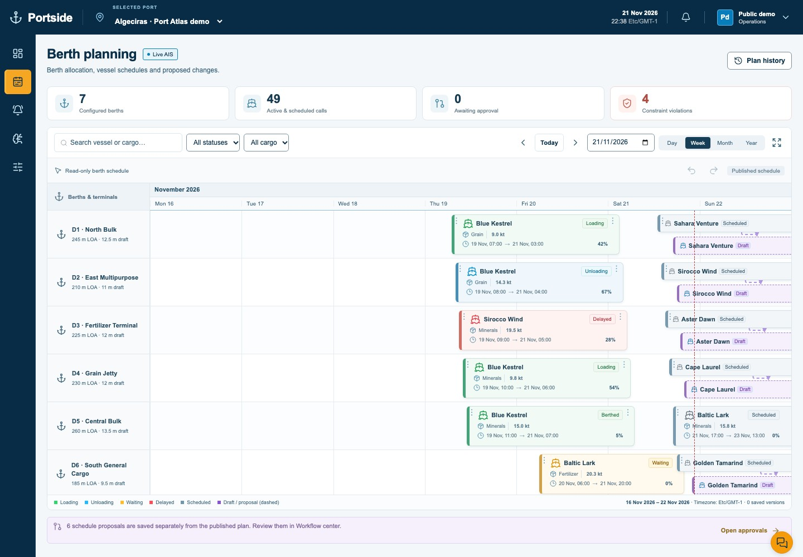
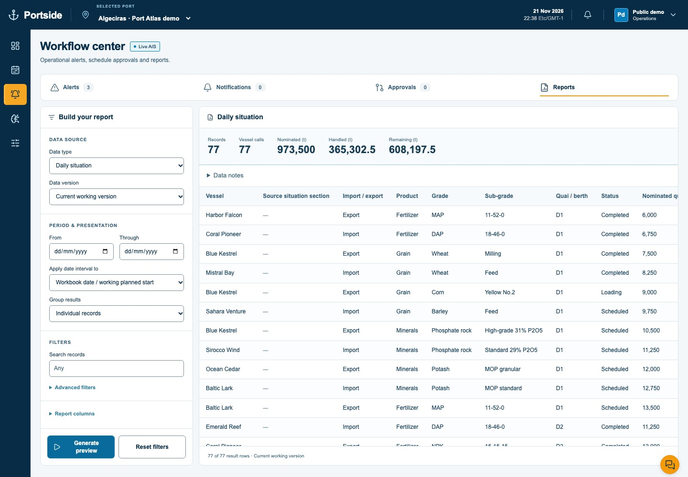
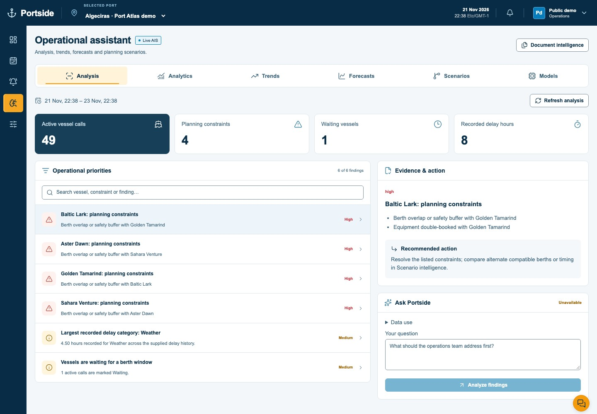
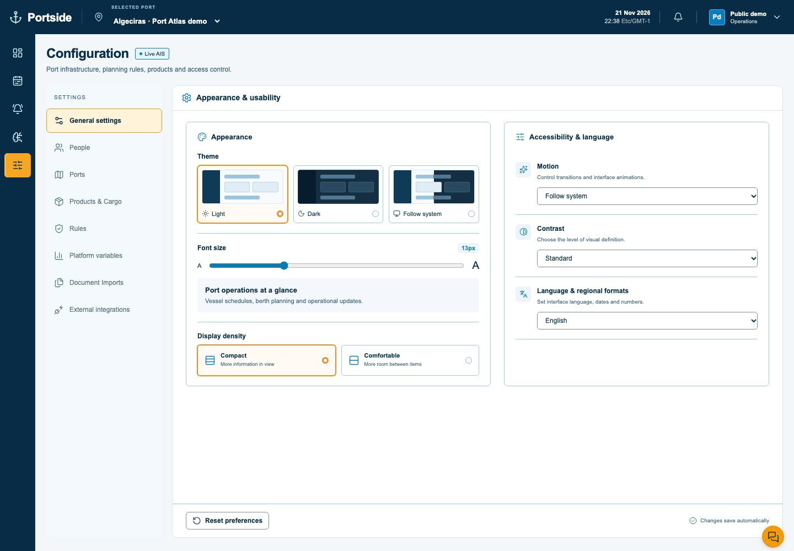

# Portside

Port operations, berth planning and approval workflows in one application.

## Screenshots

These screenshots were captured from the public Portside demo on Railway. The demo shows synthetic operational records alongside map imagery, weather and live AIS observations. A fresh installation starts with an empty workspace.





<details>
<summary>Workflows, reports, assistant and configuration</summary>







</details>

## Run locally

Requires Python 3.11 and an internet connection to install dependencies. Node.js is only needed for development checks.

```sh
git clone https://github.com/bouhdadihamza00-cmd/berth-planning.git
cd berth-planning
python3.11 -m venv .venv311
.venv311/bin/python -m pip install -r requirements-lock.txt
.venv311/bin/python scripts/create_workspace.py
./scripts/start.sh
```

Open **http://127.0.0.1:8000** and sign in with the email and password you chose during setup. The setup command creates one administrator, your organization and an empty port workspace. It refuses to overwrite an existing installation.

Configure your port location, berths, equipment, products, people and approval rules in Configuration. Add vessel calls through Berth planning or import your own documents. New calls require a berth before saving.

## Data privacy and empty installations

- Application startup creates the schema only. It does not load ports, users, vessel calls, cargo catalogues, workbooks or demonstration records.
- No shared default login or password is supplied. Setup requires your own password of at least 12 characters.
- Local databases, uploaded documents, connector sessions, credentials and exports are excluded from Git. Do not add private files with `git add -f`.
- The screenshots use synthetic operational records. Test fixtures are explicitly loaded by tests and are never imported by normal startup.
- The private HTML export embeds local operational records. If you generate one, keep it inside the ignored `exports/` directory and do not publish it.
- Existing local databases are preserved. Updating the application does not erase your records.

## Capabilities

- Multi-port workspaces, permissions and role-based access.
- Vessel calls, berth/equipment configuration and map placement.
- Planning timelines, draft proposals, approval steps and publication.
- Operational delays, notifications, workflow management and reports.
- Document review/import, cargo catalogues and configurable constraints.
- Optional vessel tracking, weather/marine data and AI integrations.
- Light/dark themes, adjustable text size and reduced motion.

External connectors are disabled until configured with your own authorized access. See [.env.example](.env.example), [integration documentation](docs/integrations.md), [weather](docs/weather.md), [marine data](docs/marine-data.md) and [AI setup](docs/ai-assistant.md). Provider availability and terms apply. Weather/marine observations are informational; operational berthing decisions require local verification.

## Client trial hosting

Try the hosted application: **[Open the Portside demo](https://berth-planning-production.up.railway.app/)**.

| Public demo login | Value |
| --- | --- |
| Email | `demo@portside.local` |
| Password | `PortsideDemo2026!` |
| Access | Read-only, isolated demo workspace |

The public account can browse the interface but cannot create, edit or delete records, manage users, or access the private client workspace. The hosted demo contains a synthetic Port Atlas product catalogue, seven unplaced docks and a personnel directory. A separate illustrative scenario contains 77 calls with completed, active, delayed and upcoming operations, seven unmapped demo handling units, recorded delays and six schedule proposals. Its 168 original PDF vessel calls remain in document review until vessel lengths and drafts are supplied; scenario dimensions and actuals are synthetic. The map is centred on Algeciras with live vessel observations through the configured tracking client; fictional docks and equipment have no map placement. Source documents use fixed UTC+01:00, which the demo preserves. Fresh clones remain empty and require their own administrator setup.

This deployment runs on Railway's usage-limited trial and may sleep when idle or become unavailable when the trial credit expires. No OCP data is included. See [client trial hosting](docs/client-trial-hosting.md) for deployment, persistent storage and backup instructions.

## Development

```sh
npm ci
npm run check
node --test tests/*.test.mjs
.venv311/bin/python -m unittest discover -s tests -v
```

Tests use temporary databases and explicit synthetic fixtures. No private workbooks are required.

The shared interface conventions are documented in [DESIGN.md](DESIGN.md).

The frontend uses browser ES modules, Leaflet and Lucide. The backend uses FastAPI, SQLite and OR-Tools. This is a local application foundation; production deployments need authentication and infrastructure hardening appropriate to their environment. See [architecture](docs/architecture.md) and [third-party licenses](docs/third-party.md).
