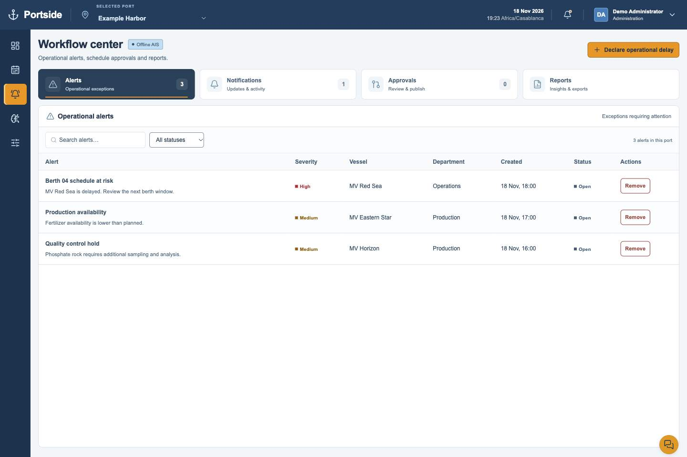
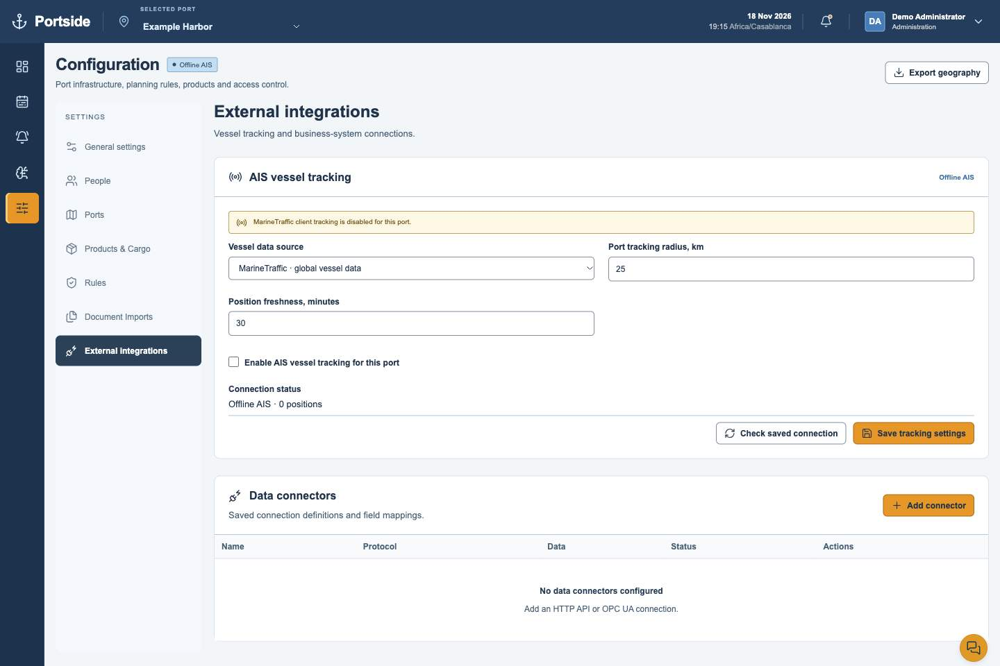

# Portside

Port operations, berth planning and approval workflows in one application.

## Screenshots

These captures use synthetic operational records in a separate example workspace, with public map imagery and weather. No customer records are included. A fresh installation starts empty; this example is not loaded on startup.


<details>
<summary>Workflows, reports, assistant and configuration</summary>






</details>

## Run locally

Requires Python 3.11 and an internet connection to install dependencies. Node.js is only needed for development checks.

```sh
git clone https://github.com/bouhdadihamza00-cmd/berth-planning.git
cd berth-planning
python3.11 -m venv .venv311
.venv311/bin/python -m pip install -r requirements-lock.txt
.venv311/bin/python scripts/create_workspace.py
./scripts/start.sh
```

Open **http://127.0.0.1:8000** and sign in with the email and password you chose during setup. The setup command creates one administrator, your organization and an empty port workspace. It refuses to overwrite an existing installation.

Configure your port location, berths, equipment, products, people and approval rules in Configuration. Add vessel calls through Berth planning or import your own documents. New calls require a berth before saving.

## Data privacy and empty installations

- Application startup creates the schema only. It does not load ports, users, vessel calls, cargo catalogues, workbooks or demonstration records.
- No shared default login or password is supplied. Setup requires your own password of at least 12 characters.
- Local databases, uploaded documents, connector sessions, credentials and exports are excluded from Git. Do not add private files with `git add -f`.
- The screenshots contain synthetic data. Test fixtures are explicitly loaded by tests and are never imported by normal startup.
- The private HTML export embeds local operational records. If you generate one, keep it inside the ignored `exports/` directory and do not publish it.
- Existing local databases are preserved. Updating the application does not erase your records.

## Capabilities

- Multi-port workspaces, permissions and role-based access.
- Vessel calls, berth/equipment configuration and map placement.
- Planning timelines, draft proposals, approval steps and publication.
- Operational delays, notifications, workflow management and reports.
- Document review/import, cargo catalogues and configurable constraints.
- Optional vessel tracking, weather/marine data and AI integrations.
- Light/dark themes, adjustable text size and reduced motion.

External connectors are disabled until configured with your own authorized access. See [.env.example](.env.example), [integration documentation](docs/integrations.md), [weather](docs/weather.md), [marine data](docs/marine-data.md) and [AI setup](docs/ai-assistant.md). Provider availability and terms apply. Weather/marine observations are informational; operational berthing decisions require local verification.

## Development

```sh
npm ci
npm run check
node --test tests/*.test.mjs
.venv311/bin/python -m unittest discover -s tests -v
```

Tests use temporary databases and explicit synthetic fixtures. No private workbooks are required.

The shared interface conventions are documented in [DESIGN.md](DESIGN.md).

The frontend uses browser ES modules, Leaflet and Lucide. The backend uses FastAPI, SQLite and OR-Tools. This is a local application foundation; production deployments need authentication and infrastructure hardening appropriate to their environment. See [architecture](docs/architecture.md) and [third-party licenses](docs/third-party.md).
